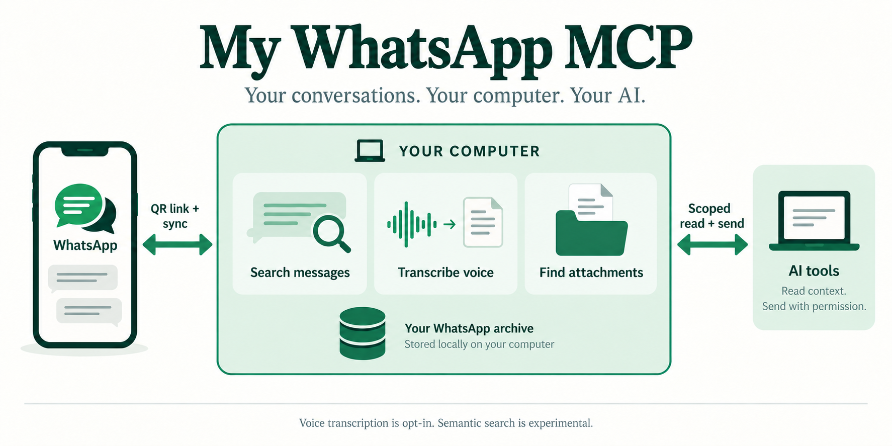
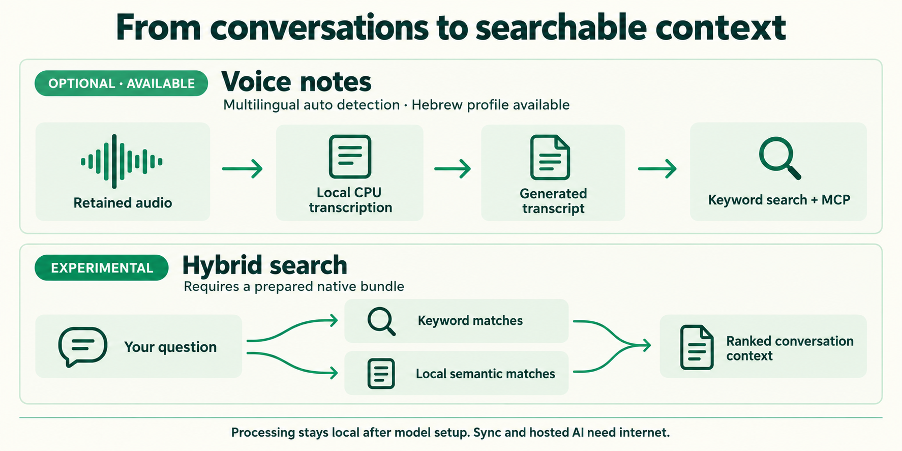
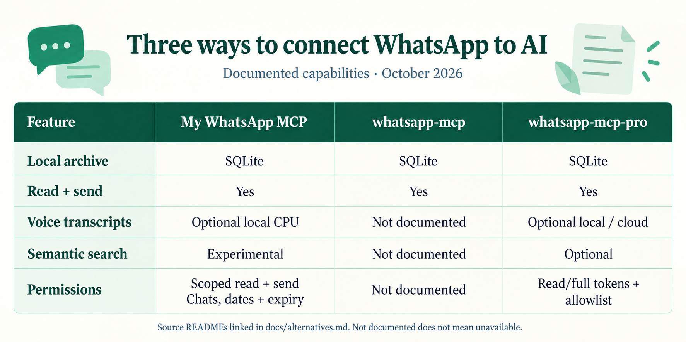

<p align="center">
  
</p>

# My WhatsApp MCP

**Search your WhatsApp archive, transcribe voice notes locally, and let AI tools read chats and send messages with your permission.**

Link WhatsApp by QR code. Keep the archive on your computer. Search saved conversations in Hebrew and English, find attachments with their surrounding messages, and connect Codex, Claude Code, or Composio through MCP. Each client gets its own chat scope, dates, and expiry. MCP supports **read + send**: text, media, and existing voice recordings to contacts and groups. New connections start read-only; you can grant sending to selected chats or all permitted chats from the owner interface.

[**Set up locally**](docs/setup.md) · [Voice transcription](docs/transcription.md) · [Attachments](docs/attachments.md) · [MCP clients](docs/mcp.md) · [Roadmap](docs/roadmap.md) · [Alternatives](docs/alternatives.md)



## What you can do

| Feature | Available today |
| --- | --- |
| Archive chats and groups | QR linking, chat and date selection, local SQLite storage, and visible history coverage. |
| Search messages | Hebrew and English keyword search, filters, and surrounding conversation. No model needed. |
| Find contacts and groups | Search names within the readable archive, then inspect their messages. |
| Transcribe voice notes | Optional local CPU service with multilingual detection and a Hebrew-specific profile. Transcripts join keyword search. |
| Find and download attachments | Search filenames, types, captions, and nearby messages; retrieve permitted originals. Documents are limited to 8 MiB. |
| Connect AI tools | Local MCP adapter or your own HTTPS tunnel. Per-client scope and expiry; read-only by default. |
| Send with permission | Text, attachments, and existing voice recordings to direct chats and groups. You grant sending separately to selected chats or all chats within the client's scope. |
| Follow import progress | A responsive Stats page with chat, date, and type filters, saved-message counts, and media processing status. |

Semantic and hybrid search, image OCR, and image descriptions are **experimental**. They require a separately prepared native bundle; there is no supported one-command installer or selected semantic release profile yet. See [native models](docs/native-models.md).

## Start locally

You need **Go 1.27.1, a C compiler, and a browser** on macOS 14 or newer, or Linux. The basic app needs no Docker, Node.js, Python, model download, or paid API. Windows is unsupported.

```sh
git clone https://github.com/Bodokh/my-whatsapp-mcp.git
cd my-whatsapp-mcp
./scripts/app/build.sh
./bin/wa-indexer serve
```

The app opens a private owner window at `http://127.0.0.1:64165`. Keep the terminal running. Follow the [setup guide](docs/setup.md) to discover chats, choose what to archive, and verify an import. If the repository is private, cloning requires a GitHub account with access. The executable remains `wa-indexer` for existing installations.

Want to look around first? Run `./bin/wa-indexer demo` instead. It uses synthetic Hebrew and English conversations in a separate archive and never connects to WhatsApp. Stop it with Ctrl+C before starting your own archive.

## Search the words you remember

Keyword search works immediately. Optional voice transcription adds the words from recordings to the same search, with generated text kept separate from the original message. Attachment search uses the filename, caption, type, and nearby conversation; it does not read the document's body.



With an MCP client connected, try requests like these using your own archived chats:

- “Find the PDF named proposal in Project Planning from last week.”
- “Search my voice notes for ‘delivery date’.” — requires transcription setup.
- “Show the messages before and after ‘Friday at 10’.”
- “Find archived groups named Weekend plans.”

These examples use fictional chat names. An AI client's ability to read a retrieved PDF depends on its file support. See [attachment search and downloads](docs/attachments.md) for the tool arguments and limits.

## Voice transcription on your computer

The optional [transcription setup](docs/transcription.md) uses faster-whisper on CPU with INT8 inference. The default multilingual profile detects the language automatically; an ivrit-ai profile supports a dedicated Hebrew setup. Model and language settings are configurable.

This service needs Python 3.11 and about **1.6 GB of model files**, plus its Python environment and recordings. Installation downloads dependencies and weights. After installation, transcription uses the verified local model without an external speech API. It runs one inference at a time; speed, memory use, and accuracy depend on your hardware and recordings.

## What stays local

Stored-message search and configured transcription run on your computer. The archive and original-media cache live in a private data directory, with a configurable media disk budget.

WhatsApp linking, sync, media downloads, and sends need internet access. Initial dependency and model installation also needs internet. Connecting a hosted AI client shares its permitted results with that service; remote MCP access also passes through your tunnel provider.

SQLite files are **not encrypted by the app**. Use OS disk encryption and protect backups. MCP clients cannot change their own permissions; you can edit sending access or revoke a connection in the owner interface. See [security](SECURITY.md) and [MCP access](docs/mcp.md).

## History and compatibility

This is an archive of what WhatsApp delivers to a linked device. Older messages, files, edits, or deletions may be missing; the app reports coverage and gaps and cannot promise a complete backup or exact current phone state.

The connection uses the unofficial [whatsmeow](https://github.com/tulir/whatsmeow) library. WhatsApp changes can interrupt linking or import. Read the [setup and troubleshooting guide](docs/setup.md) before depending on the archive.

## Compare approaches

The [comparison guide](docs/alternatives.md) compares QR-linked WhatsApp MCP projects using documented capabilities, including local storage, read and send access, voice transcription, semantic search, and permissions.



My WhatsApp MCP combines a local archive, optional offline voice transcription, scoped MCP reads and sends, and attachment search with conversation context. See the [text comparison and sources](docs/alternatives.md) for the details behind the graphic, including experimental features and differences in setup.

## What's next

The [roadmap](docs/roadmap.md) prioritizes a tested semantic and hybrid search setup, followed by local document text extraction and OCR for better file search. It also proposes reusable local message presets. [Business template messaging](docs/business-messaging.md) is a proposed separate integration with the official WhatsApp Business Platform; it is not part of today's QR-linked connector.

## Guides and development

| Guide | Use it for |
| --- | --- |
| [Setup](docs/setup.md) | Build, pair, select chats, verify import, and troubleshoot. |
| [MCP](docs/mcp.md) | Connect Codex, Claude Code, or Composio; configure remote access and permissions. |
| [Transcription](docs/transcription.md) | Install the local voice service and choose multilingual or Hebrew settings. |
| [Attachments](docs/attachments.md) | Search files with context and retrieve private originals. |
| [Outbound messaging](docs/clients/outbound-messaging.md) | Grant sending permissions and handle delivery and retries. |
| [Stats](docs/stats.md) | Understand filters, processing progress, and coverage. |
| [Native models](docs/native-models.md) | Understand experimental semantic search and image processing. |
| [Development](docs/development.md) | Package ownership, build checks, and contributing. |

See [Contributing](CONTRIBUTING.md), [Security](SECURITY.md), and the [Changelog](CHANGELOG.md). All guides are Markdown files in this repository.

Licensed under [GPL-3.0-only](LICENSE). Bundled and optional third-party components have their own notices in [THIRD_PARTY_NOTICES](THIRD_PARTY_NOTICES).
