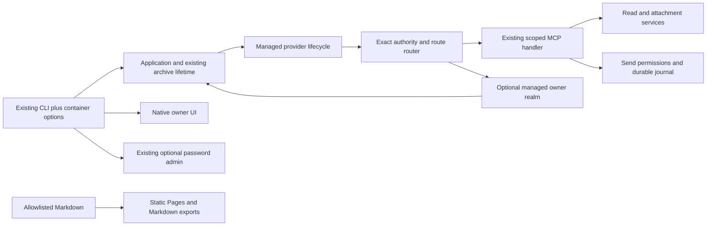

# Additive setup integration into My WhatsApp

Date: 2026-10-12. Status: implementation contract; qualification pending.

## Scope and compatibility

Integrate container setup, persistent managed remote access, optional managed phone login, and the public documentation website into main while retaining every existing main feature. Publication targets the existing repository and Pages. This work does not publish an image, tag, package, or release and does not deploy a private running archive.

The main lineage is authoritative. Retain the product name My WhatsApp, existing logo, Go module `github.com/Bodokh/my-whatsapp-mcp`, executable `wa-indexer`, archive/schema history, credentials, existing permission records, data paths, transcription service, stats, themes, responsive controls, attachments, send tools, and manual remote-admin configuration. Source from the setup implementation is an additive reference, never a replacement tree. Existing CLI flags and password-admin hashes remain compatible; no implicit schema or password migration is allowed.

## Component composition



The provider package owns ingress, reconnect intent and provider resources. The application owns archive lifetime, authorization publication, attachments, outbound journal access and the provider manager. Local UI owns owner authentication and presentation. Packaging owns image construction and source-bound qualification. Documentation rendering has no runtime role.

## Stable producer and consumer contracts

Use the donor package interfaces below, normalizing imports to the existing module. Their lifecycle semantics are part of the contract:

```go
type RemoteOwnerFactory func(context.Context, remoteaccess.Intent, string, uint64) (http.Handler, error)
// Application methods:
// NewDefaultRemoteAccessManager(RemoteOwnerFactory) (*remoteaccess.Manager, error)
// RemoteOwnerAuthenticator() (*localauth.Authenticator, error)
// ConfigureManagedMCP(context.Context, *ManagedMCPConfig) error
// ManagedMCPHandler() http.Handler
// ManagedMCPReady() bool
// ClearManagedMCP(context.Context, uint64) error

// remoteaccess package:
type Handlers struct {
    MCP http.Handler
    Owner http.Handler
    Release func(context.Context) error
}
type ManagerConfig struct {
    Store Store
    Adapters map[Provider]Adapter
    Prepare func(context.Context, Intent, string, uint64) (Handlers, error)
    MCPReady func() bool
}
```

`Intent` retains Version, Provider, Enabled, ExposeBrowser, SavedOrigin and NodeName. `Adapter.Open(ctx, intent, secret, notice)` returns a Session whose Origin, Listener, Done and idempotent Close are owned by the manager, including a nonnil session returned alongside an error. Adapters do not start HTTP serving. Prepare and Release run outside manager locks. Release clears only its captured generation; the application generation high-water mark survives failed preparation, resets and manager reconstruction and fails closed on overflow.

Preserve `localui.RemoteConfig`, `NewRemote` and `RemoteServer` for existing password-admin callers. Add donor managed authentication under distinct `ManagedRemoteConfig` and `NewManagedRemote` names:

```go
type ManagedRemoteConfig struct {
    Context context.Context
    Origin string
    Generation uint64
    Authenticator *localauth.Authenticator
    SessionTTL time.Duration
}
// NewManagedRemote(ManagedRemoteConfig, Application) (*Server, error)
```

The managed factory captures the exact provider origin and generation context, gets the shared app-owned authenticator lazily, and creates no bootstrap/attach capability. Native, existing password admin, and managed owner realms remain explicit. Do not infer native authority merely because `Server.remote == nil`: the existing password-admin dispatcher also has that value. Provider/password management and provider sign-in disclosure stay native-only in both the outer router and handler. Existing legacy login endpoints, hash configuration and owner revocation links stay intact.

The local UI app surface adds RemoteAccessStatus, ConfigureRemoteAccess, DisableRemoteAccess, RemoveRemoteAccess, SetRemoteOwnerPassword and RemoteAccessSignIn using the donor DTOs. These are optional interfaces and must not enlarge the base Application interface unnecessarily. Public status contains no secrets; sign-in links are owner capabilities. Managed routes use challenge-based login, bounded Argon2 work, secure strict cookies, CSRF, exact origin and generation revocation. Password replacement invalidates old sessions; provider removal preserves the independent password; explicit archive deletion closes its authenticator and removes the record.

## MCP and attachment preservation

Managed HTTP must construct the same main handler configuration as existing transports: `Outbound: application`, `Attachments: current attachment service`, NativeClients and RemoteClients registries, correct bearer mode and exact authority. Preserve main's `mcpListeners.root`, cancel, request wrapper and cleanup semantics. Do not transplant the donor's shorter listener struct or read-only handler configuration.

The provider router forwards `/mcp`, the four exact `/api/send/message`, `/api/send/media`, `/api/send/voice`, `/api/send/status` paths, and canonical attachment paths recognized by `mcpserver.AttachmentDownloadRoute` to `Handlers.MCP`, even when browser exposure is disabled. Never add a blanket `/api/` prefix or let owner cookies authorize these calls. Existing bearer, expiry, revocation, scope, payload limits, response checks and ticket checks remain authoritative.

The attachment service captures its public URL and archive lifetime. Managed origin discovery must bind ticket URLs to the current authority even if native MCP started first. Do not replace a shared attachment service while native handlers still reference it. Implement a synchronized authority update on the existing service or a clearly scoped remote facade; invalidate old tickets atomically when authority changes. Retain bounded ticket expiry, source invalidation and final credential checks. Tests must cover native-first startup, managed reconnect, changed authority and stale-ticket denial.

Managed request admission cancels and joins requests before its archive resources are closed. Compose this with the existing MCP request wrapper and connector send lifecycle: no duplicate send runtime, database owner, permission store or journal is introduced. Failed stop/join retains the archive lease and shutdown fence. Do not clear ownership on timeout. Preserve same request ID/payload replay and conflict denial, outcome_unknown, post-upload authority rechecks, and permission expiry/revocation during in-flight work.

## Lifecycle and storage

Create providers from the app's existing Paths and InstanceLock after successful owner composition. Add optional remote storage below the existing private root without changing other paths or repairing permissions broadly. Retain held-directory and peer checks for Unix transport, private ownership validation and narrowly validated public Tailscale cache exceptions. Unsafe optional remote state disables remote access without blocking local archive startup. Provider SDK state directories are opened lazily and closed before removal.

Close/reset first fence new remote operations, stop provider ingress, cancel and join managed requests, and close the managed authenticator without holding app ops/data locks across those joins. Then preserve main's existing connection recovery, local-AI, MCP, runtime, resource, database and lease sequence. Retain transcription configuration on reset. A single bounded shutdown budget applies across CLI owner servers and app cleanup; retries must not invent a new total deadline. Deadline failure is not clean shutdown.

Manual MCP configuration continues to win over managed setup; managed status reports manual mode without altering existing manual configuration. A manual password-admin listener can remain available independently. Shared-origin cookie use must not produce shared authority: different realms validate their own records and generation, and conflicting listener/authority configurations fail before publication.

## Container and boot requirements

Container flags explicitly distinguish an internal wildcard listener from a canonical literal-loopback browser origin. The default published host port remains loopback. Native binding stays literal loopback. Host/Origin checks never trust forwarded request metadata. Add health and owner-link commands without removing other commands. Health reports readiness only, before pairing; owner-link emits a short-lived capability only on explicit invocation and never in ordinary container logs.

Use the trusted `clientsetup.DockerRunner{Container string}` and literal argv `docker exec -i <container> /usr/local/bin/wa-indexer mcp stdio --config <private-config>`. Do not mount Docker sockets or host private Unix sockets, spawn a second archive, invoke a shell, add TTY, or discard larger outbound payload support.

Use the existing pinned multistage setup Docker design with a nonroot read-only minimal runtime, private persistent volume, dropped capabilities and bundled verified Cloudflare helper. Preserve build-time caches and dependency-before-source layers. Runtime readiness must require no compilation, download, model load, provider connectivity or WhatsApp pairing. Tailscale omit-logtail build tags, Cloudflare restricted environment/FD credentials and dependency licenses/PATENTS remain required. Optional transcription remains an optional separate service and must not become a default boot dependency. Preserve its literal-loopback endpoint validation: an optional container service can share the application network namespace when it must reach or expose 127.0.0.1, with explicit private token configuration and matching port. A separate default Compose network hostname must not be advertised as compatible with a loopback-only adapter. Preserve existing native service setup alongside container guidance.

## Owner UI and documentation

Merge the wizard into main's existing markup and JS; preserve Stats, sending controls, voice/document retry, logo, theme and dropdown code. Add explicit managed-remote asset entries for app.css, app.js, theme.js, selects.js and logo.png. Add reviewed managed owner routes for existing everyday capabilities such as Stats, voice/document retry and send-permission editing with the same owner authorization and CSRF; bootstrap, attach, credential reveal, provider/password management and deletion remain excluded from the new managed realm. Keep legacy admin capabilities compatible.

The site uses the donor pinned isolated VitePress toolchain and strict export checker, with an expanded exact page allowlist for main's attachment, outbound, stats, transcription and existing setup/client guides. Preserve source Markdown and brand assets. HTML, search, page Markdown, llms.txt and llms-full.txt share the same allowlist and availability records. Include no private evidence, machine paths, owner links, credentials, generated reports or planning pages in outputs. Public Pages base is `/my-whatsapp-mcp/`; direct nested `.html` routes and exports must work there.

Prior setup source/image qualification remains historical evidence for those exact bytes. Combined main has new module, handlers, assets and image bytes and needs new qualification. Until then guide records say integration qualification pending. Never copy donor PASS/version records as current main proof. Provider account/client/device acceptance stays distinct from local synthetic tests. Pages is documentation hosting only.

## Decisions and trade-offs

| Decision | Benefits | Costs | Alternative rejected |
| --- | --- | --- | --- |
| Additive main integration | Preserves delivered features and history | Deliberate reconciliation at shared seams | Whole-tree donor replacement removes features |
| Separate managed owner constructor | Preserves legacy CLI/hash/API compatibility | Two explicitly tested owner realms | Replacing legacy auth silently migrates users |
| Existing MCP handler for all ingress | One authorization and journal implementation | Router and lifetime tests across transports | Parallel managed read-only handler loses tools |
| Lazy optional provider composition | Local startup and search tolerate outages | More explicit readiness states | Blocking providers on startup |
| Minimal runtime with verified helper | Small immutable deployment and no boot acquisition | New bytes need native image qualification | Startup helper/model downloads |
| Explicit docs allowlist | Prevents private evidence entering exports | New guides require inventory updates | Render all repository Markdown |

## Preflight self-reviews

Feature/security review: preservation risks identified and addressed in the contracts are module/schema replacement, managed handler omission of sends/attachments, native-first attachment URL binding, narrowed UI assets/routes, legacy NewRemote collision, legacy dispatcher accidentally gaining native-only provider routes, and shutdown joins losing main's lease retention. Implementation must test these exact seams. No prior donor review establishes them for combined main.

Image/boot review: dependency caching, build-time verified helper, nonroot read-only runtime and lazy providers are retained. Rebuild combined bytes and measure normal serve separately from demo/tool security tests. Compare the minimal and slim variants with the same binary when retaining comparative claims. Measure image size, HTTP readiness, Docker health, idle resource usage and SIGTERM; disconnected-network normal serve must become healthy with no acquisition/helper start. Native AMD64 remains pending until hosted native execution is observed.
